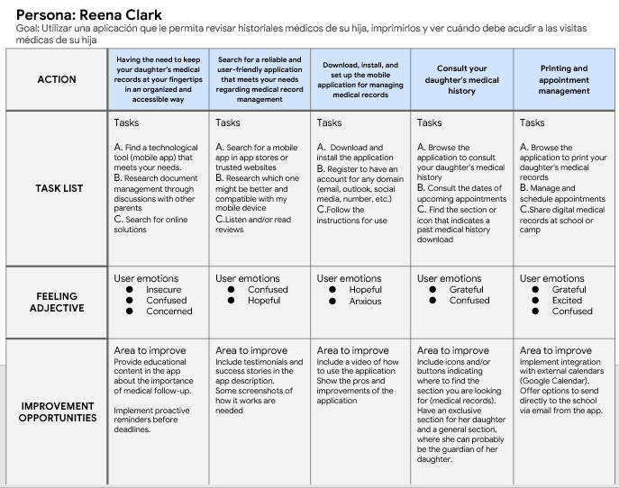

import ScreenGrid from '../../components/ScreenGrid.astro';
import sketchRegV1 from '../../assets/work/mema/sketch-register-v1.jpg';
import sketchRegV2 from '../../assets/work/mema/sketch-register-v2.jpg';
import sketchRegStep1 from '../../assets/work/mema/sketch-register-v3-step1.jpg';
import sketchRegStep3 from '../../assets/work/mema/sketch-register-v3-step3.jpg';
import sketchRegStep4 from '../../assets/work/mema/sketch-register-v3-step4.jpg';
import sketchHomeList from '../../assets/work/mema/sketch-home-list.jpg';
import sketchHomeGrid from '../../assets/work/mema/sketch-home-grid.jpg';
import sketchChildRecord from '../../assets/work/mema/sketch-child-record.jpg';
import sketchHomeFinal from '../../assets/work/mema/sketch-home-final.jpg';
import wfHome from '../../assets/work/mema/wf-home.png';
import wfStep1 from '../../assets/work/mema/wf-step1-child.png';
import wfStep2 from '../../assets/work/mema/wf-step2-health.png';
import wfStep3 from '../../assets/work/mema/wf-step3-parents.png';
import hifiWelcome from '../../assets/work/mema/hifi-welcome.png';
import hifiHome from '../../assets/work/mema/hifi-home.png';
import hifiStep1 from '../../assets/work/mema/hifi-step1-child.png';
import hifiStep2 from '../../assets/work/mema/hifi-step2-health.png';

## Contexto

El reto: diseñar una app que permita a madres y padres revisar el historial médico de sus hijos, imprimirlo para cumplir con los requisitos de la escuela o del campamento, y saber cuándo tienen las próximas visitas médicas.

Diseñé la app móvil trabajando sola en todo el proceso, en Figma. El proyecto empezó con el nombre **MEMA (Medical Management App)**, y en la etapa de alta fidelidad pasó a llamarse **SafePass**.

## El problema

Las escuelas y los campamentos piden historiales médicos actualizados, que normalmente se entregan en persona. Para madres y padres con trabajos demandantes, eso significa pedir permiso solo para entregar papeles, y además llevar el control de las citas.

**Declaración de metas:** la app permite a madres, padres y tutores gestionar el historial médico de sus hijos: agendar citas médicas, imprimir historiales y enviar historiales actualizados a la escuela o al campamento. Es para quienes tienen hijos en la escuela o en campamentos y no tienen tiempo de hacer estos trámites en persona. Su efectividad se mediría con encuestas de satisfacción.

## Usuarios

Construí dos personas basadas en personas reales. A petición suya, no incluyo sus fotos.

**Reena, 44 años — Doctora.** Tiene horarios impredecibles y una hija adolescente a la que lleva a fútbol y a escalar. Quiere herramientas que le ayuden a tener todo bajo control y a reducir el estrés del día a día. Su objetivo con este producto: revisar el historial médico de su hija, imprimirlo y saber cuándo le tocan sus próximas visitas médicas.

**Alfie, 30 años — Contador sénior.** Está comprometido con crecer en su trabajo y tiene un hijo. No puede pedir permiso para ir a la escuela de su hijo a entregar el historial médico en persona.

> Alfie es un contador sénior con una agenda apretada y un hijo, que necesita una app para organizar su trabajo y el historial médico de su hijo, porque no puede ir a la escuela a entregarlo en persona.

## User journey map

Mapeé el recorrido de Reena en cinco etapas: desde darse cuenta de que necesita tener a la mano el historial de su hija, hasta encontrar e instalar una app, consultarlo, imprimirlo y compartirlo. La confusión apareció en casi todas las etapas, y eso marcó dónde el diseño tenía que esforzarse más.

| Etapa | Emociones | Oportunidad |
| --- | --- | --- |
| Necesita el historial organizado y a la mano | Insegura, confundida, preocupada | Recordatorios antes de las fechas límite |
| Busca una app confiable | Confundida, esperanzada | Capturas y testimonios en la tienda de apps |
| La descarga y la configura | Esperanzada, ansiosa | Un video corto de cómo usarla |
| Consulta el historial de su hija | Agradecida, confundida | Íconos claros para encontrar el historial; una sección por hijo |
| Imprime, comparte y gestiona citas | Agradecida, emocionada, confundida | Integración con Google Calendar; enviar a la escuela por email desde la app |

## Storyboards

Dos storyboards definieron la experiencia antes de diseñar cualquier pantalla.

El **storyboard general** sigue a Alfie: no puede ir a la escuela de su hijo, busca una app, la encuentra, gestiona el historial desde su trabajo, lo envía a la escuela y al campamento, y se queda tranquilo.

El **storyboard de primer plano** sigue el flujo dentro de la app: abrirla, crear una cuenta o iniciar sesión, registrar al niño, subir su historial médico y luego enviarlo o imprimirlo, hasta que el historial llega a la escuela por email.

## Bocetos

Empecé en papel. El **registro del niño** pasó por tres versiones: primero, una sola pantalla con los datos del niño, los de su madre o padre y las instituciones; después, esa misma pantalla dividida en secciones con título; y al final, un flujo de cuatro pasos cortos: datos del niño, datos de salud, datos de la madre o el padre, y datos de la escuela. La versión en cuatro pasos divide un formulario largo en pantallas más cortas, cada una enfocada en un solo tipo de información; si eso hace más fácil el registro es una de las cosas que va a comprobar el estudio de usabilidad.

<ScreenGrid
  cols={5}
  items={[
    { src: sketchRegV1, alt: 'Boceto a lápiz de una sola pantalla de registro con foto de perfil, campos de nombre, un carrusel con los datos de los padres y una lista de instituciones.', caption: 'v1 — todo en una pantalla' },
    { src: sketchRegV2, alt: 'Boceto a lápiz del registro dividido en secciones con título: datos personales, datos de salud y datos de los padres.', caption: 'v2 — secciones con título' },
    { src: sketchRegStep1, alt: 'Boceto a lápiz del paso 1 de 4, datos del niño: foto de perfil, botón para subirla y campos de nombre, apellido, género, edad, NSS, CURP y dirección.', caption: 'v3 — paso 1/4, datos del niño' },
    { src: sketchRegStep3, alt: 'Boceto a lápiz del paso 3 de 4, datos de los padres: campos de contacto y un familiar de contacto para emergencias.', caption: 'v3 — paso 3/4, datos de los padres' },
    { src: sketchRegStep4, alt: 'Boceto a lápiz del paso 4 de 4, datos de la escuela: escuela, CCT, dirección, horario, tutor de grupo y botón de listo.', caption: 'v3 — paso 4/4, datos de la escuela' },
  ]}
/>

Para la **pantalla de inicio** exploré una lista de acciones, una cuadrícula de tarjetas con recordatorios y una pantalla centrada en el historial de un niño, antes de llegar al diseño final: el niño registrado, una vista previa de su historial médico y su escuela o campamento, cada uno en su propia sección. En cada boceto marqué con una estrella las mejores ideas.

<ScreenGrid
  items={[
    { src: sketchHomeList, alt: 'Boceto a lápiz de la pantalla de inicio como lista: registrar niño, información médica, subir historiales médicos y citas médicas.', caption: 'Inicio — lista' },
    { src: sketchHomeGrid, alt: 'Boceto a lápiz de la pantalla de inicio como cuadrícula de cuatro tarjetas — registrar niño, historiales médicos, institución, citas médicas — más un panel de recordatorios.', caption: 'Inicio — tarjetas' },
    { src: sketchChildRecord, alt: 'Boceto a lápiz de la pantalla de un niño con un carrusel de vista previa del historial médico, una sección de escuela o campamento y una barra de navegación inferior.', caption: 'Historial del niño' },
    { src: sketchHomeFinal, alt: 'Boceto a lápiz titulado Final wireframe: niño registrado, vista previa del historial médico y escuela o campamento, separados por líneas.', caption: 'Inicio — boceto final' },
  ]}
/>

## Wireframes (en progreso)

Después pasé a Figma la pantalla de inicio y los tres primeros pasos del registro.

<ScreenGrid
  items={[
    { src: wfHome, alt: 'Wireframe digital de la pantalla de inicio: menú, búsqueda y perfil arriba; secciones de niño registrado, vista previa del historial médico y escuela o campamento, separadas por líneas divisoras.', caption: 'Inicio' },
    { src: wfStep1, alt: 'Wireframe digital del paso 1 de 4 del registro, datos del niño, con ícono de perfil en el encabezado, carga de foto, campos del formulario y botones Previous y Next.', caption: 'Paso 1/4 — datos del niño' },
    { src: wfStep2, alt: 'Wireframe digital del paso 2 de 4, datos de salud, con ícono de portapapeles en el encabezado, campos de estatura, peso, alergias, discapacidad y tipo de sangre, un botón para subir el historial médico y botones Previous y Next.', caption: 'Paso 2/4 — datos de salud' },
    { src: wfStep3, alt: 'Wireframe digital del paso 3 de 4, datos de los padres, con ícono de personas en el encabezado, campos de contacto, una sección de contacto de emergencia y botones Previous y Next.', caption: 'Paso 3/4 — datos de los padres' },
  ]}
/>

Decisiones clave hasta ahora:

- **Líneas divisoras en la pantalla de inicio**, que separan cada opción de la app en su propio grupo para que cada una destaque: el principio de región común de la Gestalt.
- **Botones Previous y Next al final de cada formulario**, que le indican al usuario que al terminar un paso puede avanzar o regresar al anterior (control y libertad del usuario).
- **Un contador de pasos (1/4, 2/4…)**, que muestra en qué parte del registro está el usuario (visibilidad del estado del sistema).
- **Un ícono en el encabezado de cada paso**, que le indica al usuario de qué trata la página en la que está.

Los formularios piden identificadores mexicanos — NSS (número de seguridad social), CURP y CCT (clave de centro de trabajo de la escuela) — porque el estudio de usabilidad está planeado con participantes en México.

## Mockups de alta fidelidad (en progreso)

Con los wireframes como base, empecé la versión en alta fidelidad, ya con el nombre SafePass: la pantalla de bienvenida, el inicio y los dos primeros pasos del registro. Respecto al wireframe, en el tipo de sangre cambié "No aplica" por **"No lo sé"**.

<ScreenGrid
  items={[
    { src: hifiWelcome, alt: 'Pantalla de bienvenida de SafePass con formas circulares moradas y grises de fondo, el texto Welcome! to SafePass. Secure. Simple. Always connected, y un botón morado First Steps, Just go ahead! con una flecha.', caption: 'Bienvenida' },
    { src: hifiHome, alt: 'Pantalla de inicio de SafePass con encabezado azul, menú y avatar: la tarjeta del niño registrado con foto, nombre, edad, estado activo y escuela; una sección Medical Record con una foto y botón View; y una sección College/Camp con los campamentos y escuelas registrados.', caption: 'Inicio' },
    { src: hifiStep1, alt: 'Paso 1 de 4, Child’s Info: foto circular del niño con botón Upload, campos de nombre, apellido, género, edad, NSS y CURP, y botones Previous y Next.', caption: 'Paso 1/4 — datos del niño' },
    { src: hifiStep2, alt: 'Paso 2 de 4, Health Info: campos de estatura en cm, peso en kg, alergias, discapacidad y tipo de sangre, con casillas Does not apply y I don’t know, botones Save y Submit, y Previous y Next en la barra inferior.', caption: 'Paso 2/4 — datos de salud' },
  ]}
/>

Las fotos de personas en los mockups son rostros generados con IA (This Person Does Not Exist); no son personas reales.

Lo que falta: la versión digital del paso 4 y el resto de las pantallas (ver, enviar e imprimir un historial, citas) en baja y en alta fidelidad.

## Siguiente paso: estudio de usabilidad

Planeé un estudio de usabilidad remoto y no moderado con cinco participantes — madres y padres con hijos en la escuela, que trabajan y tienen actividades fuera del trabajo — para responder:

- ¿Pueden registrar a sus hijos?
- ¿Cuánto tardan en subir un historial médico, y en enviarlo?
- ¿Es claro el recorrido dentro de la app?

Métricas planeadas: tasa de errores, tasa de abandono y System Usability Scale (SUS). El estudio todavía no se realiza; sus resultados guiarán la siguiente iteración.

## Lo que aprendí

La iteración no se queda en una etapa: atraviesa todo el proceso. Solo el registro del niño pasó por tres versiones en papel antes de llegar a Figma, y la pantalla de inicio por cuatro.
