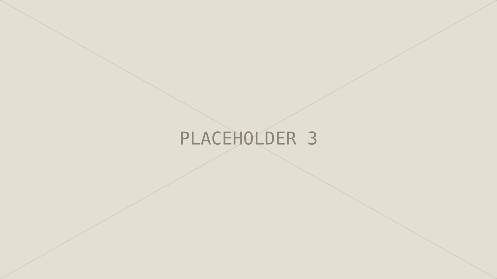

Each `##` heading becomes a numbered section automatically. Use only the sections that match the real story of the project.

## Context

What the project was, who it was for, and why it existed.

## Problem

What wasn't working, and for whom.

## Process

Research, flows, wireframes, iterations — whatever actually happened.

## Solution

The final design and the key decisions behind it.

## What I learned

Honest reflection: what worked, what you'd do differently.
